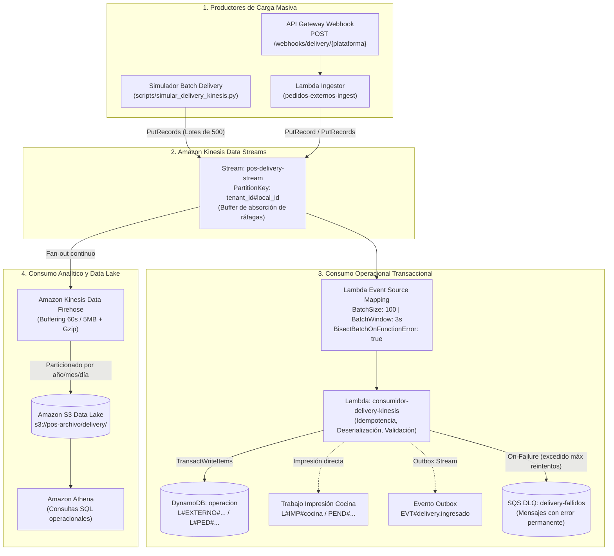

# MISE POS v3 — Contexto de Arquitectura, Análisis de Repositorio e Integración de Amazon Kinesis Data Streams para Cargas Masivas de Delivery

> **Documento de Contexto y Especificación Técnica**  
> **Proyecto:** MISE POS (Evolución de v2 a v3)  
> **Alcance:** Análisis del repositorio base (`mise_v2`), diseño e integración de Amazon Kinesis Data Streams / Data Firehose para la simulación y procesamiento batch masivo de pedidos de delivery.

---

## 1. Resumen Ejecutivo y Visión General

**MISE POS** es un sistema de Punto de Venta (POS) multi-tenant para gastronomía, diseñado bajo una arquitectura 100% *Serverless* en Amazon Web Services (AWS). Elimina la necesidad de servidores físicos en los locales y permite que el personal (garzones, cajeros, administradores y dueños) opere mediante una Progressive Web App (PWA) conectada a AWS API Gateway.

En la versión **v2**, el sistema consolidó:
1. Operación de salón y comandas asociadas a mesas físicas.
2. Caja, arqueos y turnos con control de transacciones concurrentes.
3. Mensajería asíncrona para emisión de Documentos Tributarios Electrónicos (DTE), contingencia offline de comandas y archivo histórico de auditoría en Amazon S3 consultable con Amazon Athena.

### Objetivo de la Evolución a v3 (Kinesis & Delivery Batch Streaming)
En la versión v2, la integración con plataformas externas de delivery (Uber Eats, Rappi, PedidosYa) quedó pospuesta como un esqueleto (`pedidos-externos` con autenticación HMAC que responde `501 NO_IMPLEMENTADO`), asumiendo que los pedidos requerían obligatoriamente una mesa física.

El objetivo de esta extensión es **incorporar un canal de ingesta y procesamiento de datos en streaming de alta escala mediante Amazon Kinesis Data Streams**, resolviendo:
- **Ingesta Masiva en Ráfaga (Bulk/Batch Delivery):** Capacidad de procesar ráfagas de miles de pedidos simultáneos o sincronizaciones periódicas por lotes (batch) provenientes de plataformas externas sin saturar las cuotas de API Gateway ni generar estrangulamiento (*throttling*) en DynamoDB.
- **Micro-batching y Desacoplamiento:** Ingesta de registros con baja latencia mediante `PutRecords`, desacoplando la tasa de llegada de la tasa de escritura transaccional.
- **Doble Consumo (Fan-Out):** Procesamiento operacional hacia DynamoDB (creación de comandas e impresión a cocina) y replicación continua hacia un Data Lake en S3 vía **Amazon Kinesis Data Firehose** para análisis en tiempo real mediante Athena.
- **Simulador de Carga Batch:** Herramienta para generar y enviar ráfagas sintéticas de pedidos de delivery simulando plataformas agregadoras.

---

## 2. Análisis Exhaustivo del Repositorio Actual (`mise_v2`)

El repositorio `mise_v2` implementa una arquitectura limpia, desacoplada y orientada a eventos (*Event-Driven Architecture*), dividida en las siguientes capas:

### 2.1 Estructura de Componentes y Código
- **`pwa/`**: Aplicación cliente en React con soporte offline (IndexedDB), autenticación OAuth 2.0 (Google ID Token) y paneles de administración, salón, caja y mensajería.
- **`lambdas/capa/python/pos_dominio/`**: Capa Lambda compartida (*Lambda Layer*) con arquitectura hexagonal.
  - `operaciones/`: Lógica de negocio pura (apertura de turno, cobro, comandas, etc.) sin dependencias de AWS.
  - `mensajeria.py`: Catálogo central y único de la mensajería asíncrona (canales, rutas, avisos, colas y temas).
  - `claves.py`: Constructor centralizado de particiones y claves de ordenamiento para DynamoDB.
  - `infra/`: Adaptadores a servicios AWS (`aws.py`, `mensajeria_aws.py`, `dynamodb.py`, `http.py`).
- **`lambdas/funciones/`**: 14 microservicios Lambda especializados:
  - `salon`: Gestión del plano de mesas y estados.
  - `pedidos`: Creación y ciclo de vida de comandas de mesa.
  - `caja`: Turnos, pagos, arqueos, retiros y conciliaciones.
  - `administracion`: Catálogo de productos, personal, configuración de impresoras y locales.
  - `reportes`: Consultas de agregados de ventas del turno y del día.
  - `impresion`: Despacho de tickets de comanda y boleta a impresoras térmicas.
  - `contingencia`: Recepción de comandas en modo offline/falla de red local.
  - `reservas`: Esqueleto de reservas.
  - `pedidos-externos`: Esqueleto del webhook de delivery (valida HMAC-SHA256 y retorna 501).
  - `mensajeria`: Administración de canales, reglas de distribución, destinos y redrive de mensajes fallidos.
  - `procesador-eventos`: Consumidor de DynamoDB Streams (`EVT#`); genera agregados, archivos S3, comprobantes y publica avisos SNS.
  - `emision-dte`: Consumidor SQS de `dte-emision`; interactúa con el proveedor de facturación electrónica.
  - `drenador-contingencia`: Consumidor SQS FIFO de `contingencia-comandas.fifo`; reaplica comandas en orden estricto por mesa.
  - `tareas-programadas`: Cron de EventBridge (cada 5 min) para reencolar DTEs atascados y vigilar turnos/impresoras.
- **`infra/`**: Scripts de despliegue idempotente (`cloudshell/desplegar.sh`), esquemas DDL de Athena (`athena/eventos.sql`).
- **`scripts/`**: Empaquetador (`empaquetar.py`), servidor de desarrollo local mock (`servidor_local.py`) y pruebas end-to-end en la nube (`probar_nube.py`, `validar_despliegue.py`).
- **`tests/`**: Suite exhaustiva de pruebas con `pytest` (pruebas unitarias de dominio puro, mocks de DynamoDB/SQS/SNS con pruebas de concurrencia y simulación de fallos).

### 2.2 Modelo de Datos en DynamoDB (Single-Table Design)
El sistema utiliza dos tablas con facturación bajo demanda (*On-Demand*):
1. **`configuracion`**: Datos estáticos y membresías de personal. Claves: `PK=USER#<sub>`, `PK=TENANT#<t>#LOCAL#<l>`, etc.
2. **`operacion`**: Datos transaccionales y de negocio. Habilita DynamoDB Streams con vista `NEW_IMAGE` y filtro exclusivo para ítems con prefijo `EVT#`.
   - **Patrón Outbox Garantizado:** Cada cambio de estado de negocio guarda en la misma transacción atómica (`TransactWriteItems`) el ítem del estado (`PEDIDO`, `TURNO`, etc.), el registro de comando (`CMD#<command_id>`) para idempotencia, y el evento de dominio (`EVT#<event_id>`).
   - **Control Optimista de Concurrencia:** Los ítems críticos poseen un atributo numérico `version`. Cada escritura exige `ConditionExpression: version = :v_leida`.

### 2.3 Patrón de Mensajería Actual vs. La Brecha de Delivery
El sistema maneja mensajería asíncrona mediante SQS (colas estándar y FIFO) y SNS (temas `pos-avisos-dueno` y `pos-alertas-tecnicas`).
Sin embargo:
- **Cuello de Botella en Carga Masiva:** Si una cadena gastronómica o local de alta demanda recibe 2.000 pedidos/minuto desde plataformas como Rappi o Uber Eats durante horas peak (almuerzo/cena), invocar directamente la API síncrona satura los límites de concurrencia de Lambda (cuota estándar de 1.000 o límite restringido en AWS Academy Learner Lab) y genera throttling en DynamoDB.
- **Falta de Abstracción de Pedido sin Mesa:** En v2, todo `PEDIDO` está atado a una `MESA#m`. El prefijo `L#EXTERNO#...` fue reservado en `01-modelo-dynamodb.md §4.4`, pero no implementado.
- **Carencia de Pipeline de Streaming:** No existía Kinesis Data Streams para ingestión continua, micro-batching ni analítica en tiempo real de delivery.

---

## 3. Arquitectura Propuesta: Amazon Kinesis Data Streams para Cargas Masivas de Delivery

Para integrar la ingesta batch y streaming de pedidos externos, se incorpora **Amazon Kinesis Data Streams** junto con **Amazon Kinesis Data Firehose**.

### 3.1 Justificación Técnica: Kinesis vs. SQS vs. API Síncrona

| Criterio | API Síncrona (v2 actual) | Amazon SQS | Amazon Kinesis Data Streams (v3 propuesto) |
|---|---|---|---|
| **Comportamiento ante ráfagas (Spikes)** | Riesgo de 429/504 en el webhook externo. Saturación de concurrencia Lambda. | Absorbe ráfagas, pero requiere escalado independiente de funciones consumidoras. | **Excelente.** Actúa como búfer de absorción de ráfagas masivas (*shock absorber*) sin sobrecargar el backend. |
| **Ingesta por Lotes (Batch Put)** | N/A (1 HTTP request por pedido). | Lotes de hasta 10 mensajes (`SendMessageBatch`). | **Lotes masivos de hasta 500 registros o 5 MB por llamada (`PutRecords`).** Ideal para simulaciones y sincronizaciones batch. |
| **Ordenamiento Garantizado** | No garantizado concurrentemente. | FIFO garantiza orden pero limita a 300 msg/s por grupo (3.000 con high-throughput). | **Garantizado por Partition Key (`tenant#local`)** por shard, con throughput de 1 MB/s o 1.000 registros/s por shard. |
| **Consumo Múltiple (Fan-out)** | No. | Requiere patrón SNS + múltiples colas SQS suscritas. | **Nativo.** Múltiples consumidores independientes (Lambda operacional + Firehose analítico) leen el mismo flujo sin duplicar envíos. |
| **Data Lake & Analítica** | Manual (código custom Lambda a S3). | Manual. | **Nativo con Firehose.** Ingesta continua en S3 particionado para Athena/QuickSight sin código. |

---

### 3.2 Diagrama de Flujo y Arquitectura del Pipeline de Delivery



---

### 3.3 Especificaciones de Amazon Kinesis Data Streams

#### Configuración del Stream
- **Nombre:** `pos-delivery-stream`
- **Modo de Capacidad:**
  - *Desarrollo / Lab:* Modo Provisioned con 2 Shards (suficiente para 2.000 escrituras/segundo y 2 MB/s).
  - *Producción:* Modo On-Demand (escala automáticamente según la demanda de las plataformas externas).
- **Período de Retención:** 24 horas (ampliable hasta 7 días en contingencia severa).
- **Partition Key:** `f"{tenant_id}#{local_id}"`.
  - *Ventaja:* Todos los pedidos dirigidos al mismo local y restaurante caen en el mismo shard, garantizando el orden cronológico estricto de llegada sin desordenar las órdenes del mismo restaurante.
  - Al mismo tiempo, diferentes locales se distribuyen uniformemente entre los distintos shards disponibles mediante el hashing de MD5 interno de Kinesis.

#### Event Source Mapping (Lambda Consumer)
- **Función:** `consumidor-delivery-kinesis`
- **Tamaño del lote (`BatchSize`):** 100 registros (óptimo para balancear tiempo de ejecución de Lambda y rendimiento).
- **Ventana de lote (`BatchWindowInSeconds`):** 2 segundos (acumula micro-lotes para evitar invocaciones de Lambda por registros únicos).
- **`BisectBatchOnFunctionError`:** `true`. Si un lote falla en el procesamiento, Kinesis lo divide automáticamente en dos sub-lotes y los reintenta de forma aislada, aislando el registro corrupto (*poison pill*).
- **`MaximumRetryAttempts`:** 3 intentos antes de desviar el registro.
- **Destino ante fallo (`On-Failure Destination`):** Cola SQS `delivery-fallidos.fifo` o estándar para posterior inspección y reenvío desde la PWA.
- **`ReportBatchItemFailures`:** `true`. Permite a Lambda retornar qué ítems específicos fallaron (`itemIdentifier`), evitando reprocesar los registros que ya fueron guardados exitosamente en DynamoDB.

---

### 3.4 Modelo de Datos en DynamoDB para Pedidos de Delivery

Se habilitan las claves reservadas en `01-modelo-dynamodb.md §4.4`:

| Clave Primaria (`PK`) | Clave de Ordenamiento (`SK`) | Entidad (`tipo_item`) | Atributos Principales |
|---|---|---|---|
| `L#EXTERNO#<plataforma>` | `ORDEN#<orden_externa_id>` | `EXTERNO_INDEX` | `pedido_id`, `plataforma`, `estado_externo`, `recibido_en`, `total`, `cliente_nombre` |
| `L#PED#<pedido_id>` | `PEDIDO` | `PEDIDO` | `tipo_pedido="delivery"`, `plataforma`, `orden_externa_id`, `estado="abierto"`, `canal="kinesis"`, `version=1`, `repartidor`, `direccion_despacho`, `telefono` |
| `L#PED#<pedido_id>` | `ITEM#<item_id>` | `ITEM` | `producto_id`, `nombre`, `cantidad`, `precio_unitario`, `notas`, `estado="enviado"` |
| `L#CMD#<command_id>` | `CMD` | `CMD` | Idempotencia: `hash_cuerpo`, `estado="aplicado"`, `http_status=200`, `expira_en` (TTL 48h) |
| `L#EVT` | `EVT#<event_id>` | `EVT` | `tipo="delivery.ingresado"`, `datos={pedido_id, plataforma, total, items}` |

---

## 4. Simulación de Cargas Masivas Batch (Delivery Batch Simulator)

Para poner a prueba la infraestructura de Kinesis frente a cargas masivas (por ejemplo, sincronización histórica o ráfagas masivas en CyberDay o promociones), se implementa un generador sintético de eventos batch en Python.

### 4.1 Formato del Payload de Delivery

Cada registro en el stream contiene el evento serializado en JSON:

```json
{
  "evento_id": "01JDX88Z1A2B3C4D5E6F7G8H9J",
  "version_esquema": "1.0",
  "origen": "kinesis.batch.simulador",
  "timestamp": "2026-11-17T14:30:00.125Z",
  "plataforma": "ubereats",
  "tenant_id": "demo",
  "local_id": "matriz",
  "orden_externa_id": "UBER-78942-CL",
  "command_id": "01JDX88Z1A2B3C4D5E6F7G8H9K",
  "datos": {
    "cliente": {
      "nombre": "Francisca Morales",
      "telefono": "+56987654321",
      "direccion": "Av. Providencia 1234, Depto 502"
    },
    "repartidor": {
      "nombre": "Carlos Gómez",
      "vehiculo": "moto"
    },
    "items": [
      {
        "producto_id": "BURGER_DOBLE",
        "nombre": "Hamburguesa Doble Queso",
        "cantidad": 2,
        "precio_unitario": 8900,
        "notas": "Sin cebolla"
      },
      {
        "producto_id": "BEBIDA_COCA_ZERO",
        "nombre": "Bebida Lata 350ml Zero",
        "cantidad": 2,
        "precio_unitario": 1800,
        "notas": ""
      }
    ],
    "subtotal": 21400,
    "propina": 2140,
    "total": 23540,
    "metodo_pago": "online_platform"
  }
}
```

### 4.2 Script de Carga Masiva: `scripts/simular_delivery_kinesis.py`
El script ejecuta:
1. Generación de $N$ pedidos sintéticos distribuidos entre múltiples plataformas (`ubereats`, `rappi`, `pedidosya`).
2. Agrupación en bloques de hasta 500 registros (límite de la API `PutRecords` de AWS Kinesis).
3. Envío con control de flujo, cálculo de latencia de red y reporte de registros rechazados por estrangulamiento (`PutRecordsResultEntry.ErrorCode`).

---

## 5. Implementación del Código en el Proyecto

### 5.1 Catálogo Central de Mensajería (`pos_dominio/mensajeria.py`)
Se incorpora el canal Kinesis al catálogo existente:

```python
# Extensión a pos_dominio/mensajeria.py

CANAL_DELIVERY_KINESIS = Canal(
    id="delivery-stream",
    tipo="kinesis_stream",
    nombre_aws="pos-delivery-stream",
    proposito="Ingesta masiva y streaming de pedidos batch desde plataformas de delivery",
    productores=("webhook-pedidos-externos", "simulador-batch-delivery"),
    consumidores=("consumidor-delivery-kinesis", "pos-delivery-firehose"),
    variable="STREAM_DELIVERY_ARN",
    fallidos="delivery-fallidos",
    tratamiento="Batch window 2s; ReportBatchItemFailures; bisect on error; DLQ tras 3 reintentos"
)
```

### 5.2 Función Lambda Consumidora: `lambdas/funciones/consumidor-delivery/lambda_function.py`
Procesa los registros provenientes de Kinesis:
- Deserializa el payload en base64 de cada registro (`record['kinesis']['data']`).
- Verifica idempotencia con `CMD#<command_id>`.
- Inserta el pedido transaccional en `operacion` (`PEDIDO` + `ITEM`s + `CMD` + `EVT`).
- Registra `batchItemFailures` si ocurre un error inesperado para reintentar solo los fallidos.

---

## 6. Monitoreo, Observabilidad y Métricas en CloudWatch

Para garantizar la estabilidad en cargas masivas, se monitorean las siguientes métricas de CloudWatch:

1. **`IncomingBytes` y `IncomingRecords` (Kinesis):** Volumen de datos y pedidos por segundo recibidos en el stream.
2. **`WriteProvisionedThroughputExceeded` (Kinesis):** Si sube sobre 0, indica que la tasa de inyección de la simulación o de las plataformas de delivery superó la capacidad de los shards asignados (señal para agregar shards o activar Auto-Scaling).
3. **`IteratorAgeMilliseconds` (Lambda Event Source):** La métrica más crítica. Mide el tiempo que los registros pasan en el stream antes de ser procesados por la función Lambda. Un valor creciente indica que el consumidor no da abasto con la tasa de llegada (señal para aumentar `ParallelizationFactor` o reducir el tiempo de ejecución por lote).
4. **`BatchItemFailures` (Lambda):** Cuenta de registros defectuosos derivados a la DLQ.

---

## 7. Plan de Despliegue y Pruebas

### 7.1 Pasos para Probar en AWS Academy Learner Lab
1. **Creación del Stream:**
   ```bash
   aws kinesis create-stream --stream-name pos-delivery-stream --shard-count 2
   ```
2. **Asociación del Disparador a Lambda:**
   ```bash
   aws lambda create-event-source-mapping \
     --function-name consumidor-delivery-kinesis \
     --event-source-arn arn:aws:kinesis:us-east-1:<CUENTA>:stream/pos-delivery-stream \
     --batch-size 100 \
     --maximum-batching-window-in-seconds 2 \
     --starting-position LATEST \
     --bisect-batch-on-function-error \
     --function-response-types ReportBatchItemFailures
   ```
3. **Ejecución del Simulador Batch:**
   ```bash
   python scripts/simular_delivery_kinesis.py --pedidos 1000 --lote 100 --plataformas ubereats,rappi
   ```
4. **Validación:**
   - Verificar en CloudWatch que `IteratorAgeMilliseconds` se mantenga < 3.000 ms.
   - Consultar la tabla `operacion` en DynamoDB para comprobar la creación de los pedidos con `tipo_pedido = delivery`.
   - Consultar en Athena los eventos históricos guardados por Firehose.
